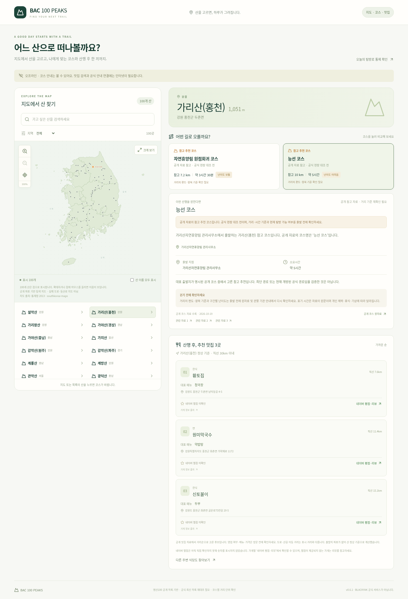

# BAC 100 PEAKS PC 0.6.1

추천 코스가 8개 산에만 있던 누락을 수정했습니다.
100개 산 모두 추천 코스가 표시되며, 추가한 183개는 공개 참고 자료로 구분합니다.
공식 확인 15개는 유지하고 참고 코스를 공식/최단으로 표시하지 않습니다.

ZIP 압축을 풀고 BAC-100-PEAKS-PC-v0.6.1.html을 Chrome 또는 Edge로 여세요.
예전 파일 대신 새 버전을 열어 주세요. 화면 하단에 v0.6.1이 표시됩니다.

단위17개, 웹8개(100개 산 실제 클릭 포함), 모바일 이동 재검사1개, PC 문서 기능 검사 통과.
공개 참고 자료는 거리의 편도/왕복 기준·시간·난이도·개방 상태 재확인이 필요합니다.
네이버 숫자 평점·최신 BAC 공식 목록 대조·실제 Windows file:// 실행은 미검증입니다.

## 새로 추가한 가리산 추천 코스의 실제 브라우저 화면

