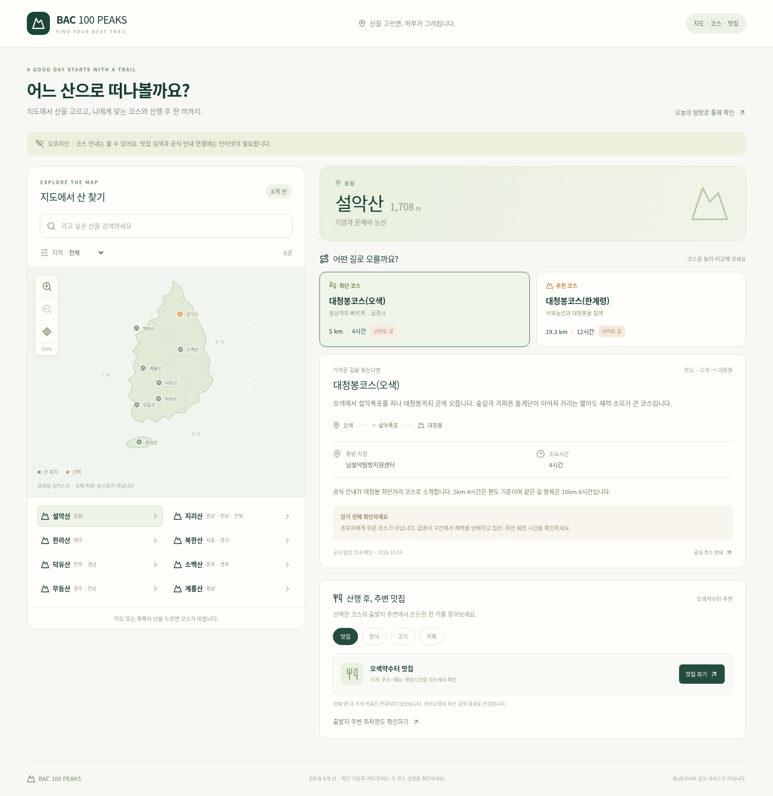
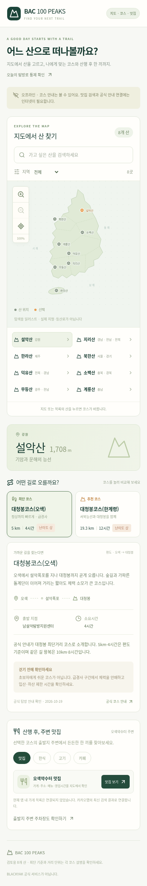

# BAC 100 PEAKS PC 0.5.0

지도 → 산 선택 → 최단·추천 코스 → 주변 맛집 검색.
완등률·산행 기록·사진 업로드·통계 화면은 제거했습니다.

ZIP 압축을 풀고 BAC-100-PEAKS-PC.html을 Chrome 또는 Edge로 여세요.
별도 설치·회원가입 없이 쓰는 단일 HTML입니다.

산 8개 · 공식 안내 확인 코스 15개 · 무등산 최단 코스 확인 중.
맛집은 코스 출발지 주변 카카오맵 검색으로 연결합니다. 앱 내 가게 목록은 미연결입니다.
지도는 탐색용 일러스트이며 실제 등산로 선을 표시하지 않습니다.

브라우저/모바일 화면 및 오프라인 기능 검사 통과. 실제 Windows 더블클릭 실행은 미검증입니다.

## 실제 브라우저 캡처

