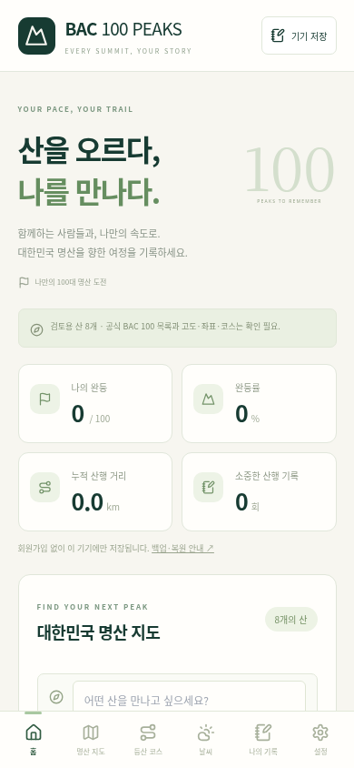
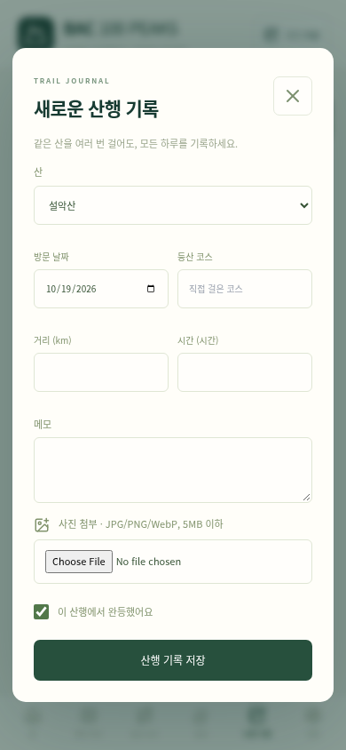

# BAC 100 PEAKS PC

[PC 파일 다운로드](https://github.com/shy4938-byte/BAC-100-PEAKS/raw/refs/heads/pc-download-v0.4.0/BAC-100-PEAKS-PC.zip)

ZIP 압축을 풀고 BAC-100-PEAKS-PC.html을 Chrome 또는 Edge로 여세요.
설치·회원가입 없이 사용합니다. 산 정보는 검토용 8개입니다.
기록은 브라우저에 저장하므로 설정에서 정기적으로 백업하세요.

Chromium에서 동일 단일 HTML의 화면, 오프라인 기록·사진 CRUD, 재실행 유지, 백업·복원 검사를 통과했습니다.
관리형 브라우저가 file://를 차단하여 로컬 문서 응답으로 검사했습니다. 실제 Windows 더블클릭 실행은 미검증입니다.

## 실제 앱 화면 (브라우저 촬영)

